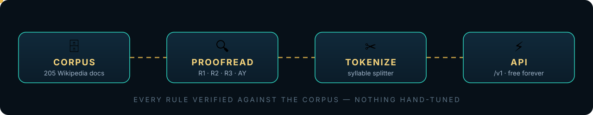

<p align="center">
  
</p>

<p align="center">
  <b>Open Burmese language data infrastructure</b> — a cleaned Myanmar Wikipedia
  corpus, a Wikipedia-verified Burmese proofreader, a rule-based syllable
  tokenizer, and a free HTTP API on top.
</p>

<p align="center">
  <b>v0.1</b> · Code: MIT · Corpus data: CC BY-SA 4.0 (derived from Myanmar Wikipedia) ·
  Live demo: <a href="https://shwecorpus.kmnapps.xyz">shwecorpus.kmnapps.xyz</a>
</p>

## မြန်မာ အကျဉ်းချုပ်

ShweCorpus သည် မြန်မာ ဘာသာစကား အတွက် open source ဘာသာစကား အချက်အလက် အခြေခံ အဆောက်အအုံ ဖြစ်သည်။ Wikipedia corpus၊ စာလုံးပေါင်း စစ်ဆေးခြင်း API၊ စကားလုံး ခွဲခြမ်း ရန် ကိရိယာ များ ပါဝင် သည်။ Developer များ အခမဲ့ ရယူ သုံး နိုင် သည်။ အသေးစိတ် ကို အောက် ပါ English အပိုင်း တွင် ဖတ် နိုင် သည်။

## Why

Every builder of Burmese-language software hits the same wall: no trusted
corpus, no spell-checker, no tokenizer — so everyone rebuilds the basics from
scratch. ShweCorpus packages the basics once, openly, so the next Burmese
chatbot, search engine, or writing tool starts from working parts instead of
an empty folder.

## How it works

<p align="center">
  
</p>

## What's inside

| Path | What |
|---|---|
| `corpus/corpus.db` | 205 cleaned Myanmar Wikipedia articles (SQLite) |
| `corpus/build_corpus.py` | Rebuild/extend the corpus from Wikipedia |
| `shwecorpus/proofread.py` | Burmese proofreader (R1/R2/R3/ay-vowel rules) |
| `shwecorpus/tokenizer.py` | Rule-based Burmese syllable tokenizer |
| `shwecorpus/api.py` | Flask HTTP API |
| `benchmarks/` | Generated proofreading benchmark + runner |
| `examples/` | Library quickstart and curl examples |
| `web/index.html` | Minimal try-it page for the demo |
| `assets/` | Animated SVG banner + pipeline diagram for this README |

## Quickstart

```bash
git clone https://github.com/mymyanmarland/shwecorpus
cd shwecorpus
pip install -r requirements.txt
```

Library (no server needed):

```python
from shwecorpus import proofread_text, fix_text, tokenize

result = proofread_text("မြန်မာစာ စစ်ဆေးခြင်း")
print(result["clean"])          # True / False
print(result["r3_suspects"])     # human-review candidates

fixed, n = fix_text("...")      # auto-fix R1 + R2 + ay-vowel
print(tokenize("မြန်မာနိုင်ငံ"))  # syllables
```

HTTP API:

```bash
gunicorn "shwecorpus.api:app" -b 127.0.0.1:3005
curl -X POST localhost:3005/v1/proofread \
  -H 'Content-Type: application/json' \
  -d '{"text": "...", "fix": true}'
```

Endpoints: `GET /v1/health`, `POST /v1/proofread`, `POST /v1/tokenize`,
`GET /v1/word/<word>` (codepoints + corpus attestation + example sentences).
See `examples/curl.md`.

## The proofreader

Four rule families, every one verified against the corpus — never hand-tuned
on a hunch:

- **R1** — the "-ai" rhyme is U+101A U+103A, never preceded by U+1031
- **R2** — AA vowel shape: tall U+102B after ခ ဂ ဒ ပ ဝ, U+102C elsewhere
- **AY** — the ay-vowel is U+1031 + U+1038 with no AA between
- **R3** — deletion test: drop one U+1031/U+103D/U+1038; if the result is a
  known word, the mark is spurious (report-only, needs human review)

Run the benchmark: `python3 benchmarks/make_cases.py && python3 benchmarks/run.py`

## Data licensing

**Code is MIT** (see `LICENSE`). **Corpus data is CC BY-SA 4.0**: `corpus.db`
is derived from Myanmar Wikipedia — see `corpus/README.md`. If you
redistribute the data, credit Wikipedia and share alike.

## Contributing

The most valuable contribution is a real-world failure report: a corrupted
string (pasted, never retyped), its codepoint dump, and where it came from.
Systematic patterns become new rules + benchmark generators. See
`benchmarks/README.md`.

## Roadmap

- v0.2: larger corpus (news/books with permission), Zawgyi → Unicode
  normalization, word-segmentation beyond syllables
- v0.3: community benchmark leaderboard, hosted API quotas
- Long term: the data layer under a Burmese LLM (corpus → evals → model)

---

Built by [Funapp](https://kmnapps.xyz) — Myanmar-first open infrastructure.
